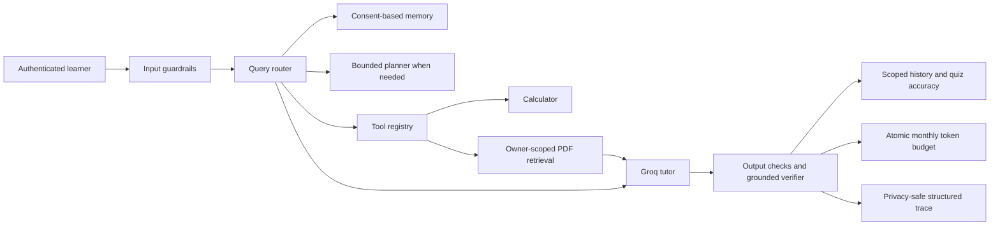

# AI Tutor

An AI-powered learning app built on the existing Streamlit, FastAPI, LangChain, MongoDB, and Pinecone stack. Learners can create private courses from a free-text topic without uploading a document. A PDF can optionally ground a course in a learner's own material.

## Requirements

- Python 3.10 or newer
- MongoDB, local or hosted
- A Groq API key for generating course curricula and lessons
- Google AI and Pinecone credentials for PDF indexing and existing document-grounded chat/quiz features

Topic-only course generation uses Groq and MongoDB. PDF upload and the existing RAG features additionally need Google AI embeddings and Pinecone. The app can start without the optional RAG provider keys; those features return a configuration error until the keys are set.

## VS Code setup

1. Open the `AI-Teaching-Assistant` folder in VS Code.
2. Open **Terminal → New Terminal** and create a virtual environment:

   ```powershell
   py -3.10 -m venv .venv
   .\.venv\Scripts\Activate.ps1
   python -m pip install --upgrade pip
   python -m pip install -r requirements-dev.txt
   ```

   If the `py` launcher is unavailable, use `python -m venv .venv` with Python 3.10 or newer.

3. In VS Code, select `.venv` as the Python interpreter.
4. Copy `.env.example` to `.env` in the project root and fill in the values. `MONGO_URI` is required to run the API. `GROQ_API_KEY` is required for course generation. Add the Google AI and Pinecone values to enable PDF upload and legacy RAG features. Keep real keys only in `.env`; `.env` is ignored by Git.
5. Ensure MongoDB is running and reachable at `MONGO_URI`.

## Run the application

Open two VS Code terminals from the project root.

**Terminal 1 — FastAPI backend**

```powershell
.\.venv\Scripts\Activate.ps1
Set-Location server
uvicorn main:app --reload
```

The API is at `http://127.0.0.1:8000`; interactive API documentation is at `http://127.0.0.1:8000/docs`.

**Terminal 2 — Streamlit frontend**

```powershell
.\.venv\Scripts\Activate.ps1
Set-Location client
streamlit run main.py
```

The root `main.py` remains a health-check-only app. Use `server/main.py` for the feature API.

## Tests

Run focused tests from the project root:

```powershell
.\.venv\Scripts\Activate.ps1
python -m pytest server/tests -v
```

The unit tests mock generated content and database writes; they do not call Groq, MongoDB, Gemini, or Pinecone. `server/test.py` is a safe configuration diagnostic and prints only whether selected settings exist. It does not print secret values and is not the test suite.

## Step 1 behavior

- Create a course using any topic and Beginner, Intermediate, or Advanced level.
- The generated curriculum includes objectives, modules, and lessons. Generate lesson content when opening a lesson.
- Lessons include explanations, worked examples, practice questions, and quizzes. Practice expected answers and quiz keys remain server-side; quiz feedback is returned after submission.
- Course data, lesson completion, and quiz attempts are stored in MongoDB and scoped to the creator's authenticated user ID.
- Optional course PDFs are limited to 15 MB, indexed as private sources, and can ground curriculum and lessons. Existing teacher uploads keep their existing public-by-grade behavior.

New MongoDB collections are created automatically by MongoDB on first write: `courses`, `lesson_progress`, and `course_quiz_history`. Existing collections are unchanged; no destructive migration is required.

## API routes added

- `POST /courses/sources` — upload an optional private PDF
- `POST /courses` — generate and save a topic curriculum
- `GET /courses` and `GET /courses/{course_id}` — list and retrieve the learner's courses
- `POST /courses/{course_id}/lessons/{lesson_id}/generate` — generate a structured lesson
- `GET /courses/{course_id}/lessons/{lesson_id}` — retrieve learner-facing lesson content
- `POST /courses/{course_id}/lessons/{lesson_id}/practice` — check practice responses
- `POST /courses/{course_id}/lessons/{lesson_id}/quiz` — grade and persist a quiz attempt
- `POST /courses/{course_id}/lessons/{lesson_id}/progress` — save lesson completion

All course reads and writes are owner-scoped. The existing signup, login, document upload, chat, and quiz routes remain available.

## Lumina same-origin web app and API integration

The responsive Lumina web client is in `client/lumina/`. `server/main.py` serves it at `/` and exposes the API on the same origin, so the default browser API base does not point to localhost in production. The existing Streamlit client remains available separately for the original workflow.

### Live API routes used by the Lumina web client

- `GET /health` reports process status and whether required service keys are configured. It does not claim that MongoDB, Groq, Google AI, or Pinecone is reachable.
- `POST /signup/student`, `GET /login` use the existing account model. Browser credentials remain in memory for the current tab and are sent with HTTP Basic; deploy behind HTTPS.
- `POST /tutor/chat` sends the learner's question, level and at most 8 recent UI messages to the configured Groq model. The server bounds history to 6,000 characters, limits output to 700 tokens, and stores the exchange under that user's ID when MongoDB is available.
- `POST /chat` remains the document-grounded path. Retrieval is limited to five chunks and 12,000 context characters. Private chunks are filtered by owner in both Pinecone and MongoDB. Responses include filename/page citations derived from retrieved chunks.
- `POST /courses/sources` validates and indexes a private text-based PDF. `GET /documents/mine` lists the authenticated user's indexed private PDFs. Scanned PDFs without extractable text are not OCRed.
- `POST /tutor/quiz` generates structured questions through Groq and stores answer keys server-side. `POST /tutor/quiz/check` validates the answer count, checks quiz ownership, returns explanations and stores the attempt.
- `GET /learning/history` returns account-scoped tutor and quiz events.

The topic tutor and quiz paths each use one model call. No percentage token savings is claimed. Provider-reported token usage is recorded when returned by the model. Retries and provider timeouts are bounded.

### Local run

From the repository root, configure `.env` from `.env.example`, then run:

```powershell
.\.venv\Scripts\Activate.ps1
Set-Location server
uvicorn main:app --reload --host 127.0.0.1 --port 8000
```

Open `http://127.0.0.1:8000`. API docs are at `/docs`; the process/configuration endpoint is `/health`. The static HTML/CSS/JS client has no separate bundler, so there is no Vite production build command. JavaScript syntax is checked with `node --check client/lumina/app.js`.

To keep the existing Streamlit client, run it separately with `BACKEND_URL=http://127.0.0.1:8000` and `streamlit run client/main.py` from the repository root.

### Environment variable names

Set these in a local `.env` or in the hosting provider's environment configuration. Never commit actual values:

- `MONGO_URI` (required for auth and persisted learner data)
- `DB_NAME` (defaults to `ai_tutor` in the sample)
- `GROQ_API_KEY` and optional `GROQ_MODEL` (topic tutor, courses and quizzes)
- `GOOGLE_API_KEY` and optional `GOOGLE_EMBEDDING_MODEL` (PDF embeddings)
- `PINECONE_API_KEY` and `PINECONE_INDEX_NAME` (PDF retrieval)
- `CORS_ORIGINS` (comma-separated trusted origins only, if the UI is hosted separately)
- `BACKEND_URL` (Streamlit client only; the bundled Lumina UI uses same-origin API calls)

If MongoDB is missing, the static UI and health route can start but account-backed routes return a configuration error. The health endpoint reports configuration flags, not successful remote connectivity.

### Render deployment preparation

`render.yaml` defines one Python web service that serves both FastAPI and the static Lumina UI, checks `/health`, and leaves secret values as provider-managed environment variables. This folder has no Git remote or Render account connection, so the blueprint is prepared but no cloud deployment or real external credentials were verified. Connect the repository to Render, set the required environment variables above, and confirm the MongoDB network allowlist before deploying. The `CORS_ORIGINS` list can stay same-origin when the UI and API use the same Render service.

## Verification scope

`python -m pytest server/tests -q` exercises unit and in-process ASGI API tests using fake provider/database boundaries. It verifies the question → FastAPI route → tutor provider contract → UI JSON shape, structured quiz answer-key privacy/scoring, user-scoped retrieval filters, and grounded citation metadata. These tests do not make live Groq/Gemini/Pinecone/MongoDB calls. Real credentials are needed for live chat, persistence and PDF-to-RAG verification.

Additional API hardening: shared teacher PDFs require an authenticated Teacher account; private learner PDFs stay owner-scoped. Tutor responses include provider/model labels, latency, and provider token counts when available. The app records these fields without logging prompt text.

## Agentic tutor features

- **Orchestrator:** `POST /tutor/chat` coordinates guardrails, learner memory, direct tutor or optional RAG, response evaluation and usage logging. The response includes an `agents` trace so the UI can show what ran.
- **Guardrails agent:** bounds question length, detects common prompt-injection phrases for extra-safe handling, keeps learner history role-allowlisted, and instructs both tutor and RAG prompts to treat learner/document text as untrusted. Detection is a safety signal, not a perfect classifier.
- **Memory agent:** stores account-scoped topic frequency and preferred level in `learner_memory`; only topic keys are reused as context. `DELETE /memory` erases the learner's saved memory.
- **RAG agent:** when the learner enables PDF grounding, retrieval is owner/grade scoped and answers include citations from indexed pages. Missing evidence is reported; retrieved documents are not instructions.
- **Evaluation agent:** returns a simple response-quality rubric and explicitly labels tutor factual accuracy as not independently verified unless the response is source-grounded. `GET /learning/accuracy` reports measurable quiz-answer accuracy from completed attempts.
- **Token control:** `GET /usage` shows estimated/provider-reported tokens for the current UTC month. `USER_MONTHLY_TOKEN_LIMIT` defaults to 250,000 tokens per student; individual requests are capped at 8,000 estimated tokens and are rejected with HTTP 429 when the budget estimate exceeds remaining quota. Groq usage metadata is recorded when present; quiz/RAG paths may use estimates. MongoDB atomically reserves estimated tokens before model calls so concurrent requests cannot overspend the application quota. This is still an application estimate, not a provider billing guarantee.

Mongo creates `ai_usage`, `usage_budgets`, `learner_memory`, and `subscriptions` on first write. A unique user/month budget index supports atomic reservations. Configure limits and provider credentials in `.env` or hosting environment; never put real keys in the ZIP.

## Agent workflow and production boundaries

The tutor uses an explicit typed workflow with bounded state transitions. A deterministic router selects direct tutoring, safe arithmetic, or document QA; the planner is invoked only for multi-part study requests. The allowlisted tool registry exposes a bounded calculator and owner-scoped PDF search, with argument schemas, student permissions, output validation, and timeouts. RAG uses private owner/grade filters, citations, and a deterministic evidence check that falls back to a source excerpt or abstains when it cannot verify the response.



### Memory, usage, evaluation, and billing

- Memory is account-scoped and user-controlled. Chat topic storage requires explicit opt-in, settings let learners disable and delete memory, and only sanitized topic labels plus learner-approved preferences are used as context.
- `GET /usage` reports current UTC-month usage, remaining quota, reserved requests, and limit. Tutor and quiz generation reserve estimated tokens before calling the provider; provider-reported usage is committed when available, otherwise the recorded count is labeled estimated. `MAX_AGENT_STEPS` bounds the workflow, and requests have separate size/token caps.
- `GET /learning/accuracy` measures scored quiz answers. The answer rubric is a quality heuristic; it is not a factual-accuracy score. Grounded answer checks are lexical and deterministic, so they can miss paraphrases or accept superficial overlap. Ungrounded tutor answers are explicitly marked `not_fact_checked`.
- `python -m evaluation.run` runs the deterministic offline evaluation on `server/evaluation/dataset_v1.json` and writes `results_latest.json`. The three fixture cases are synthetic and illustrate metric wiring; their scores are not a benchmark of Groq or real learner outcomes.
- Local JSON traces contain a hashed user reference, route, stage names, latency, token counts, retrieval count, and verification status. They omit prompts, answers, and document text. Configure log retention/redaction in the hosting platform before production.
- Razorpay routes create a subscription checkout and activate or change the plan only from signed, idempotently processed webhooks. Set `RAZORPAY_KEY_ID`, `RAZORPAY_KEY_SECRET`, `RAZORPAY_WEBHOOK_SECRET`, and `RAZORPAY_PLAN_ID_PRO`, then register `/billing/webhook` in Razorpay. Live checkout and webhook operation require real account credentials and were not exercised in local tests.

### Known deployment requirements and limits

Render configuration is a deployment blueprint; no cloud service was deployed and no external provider credentials were supplied. Set MongoDB, Groq, Google AI, Pinecone, and Razorpay secrets in Render. Verify Razorpay plan pricing and webhook event configuration in its dashboard. Use HTTPS, configure backups and data retention, and monitor provider usage separately. PDF OCR, Redis-backed queues, distributed tracing vendors, semantic/reranked hybrid retrieval, calibrated model-based factual evaluation, and live payment/provider verification are not included in this local package.

The project test suite uses mocked provider and database boundaries. It cannot prove live service availability, payment settlement, model quality, or production security.

