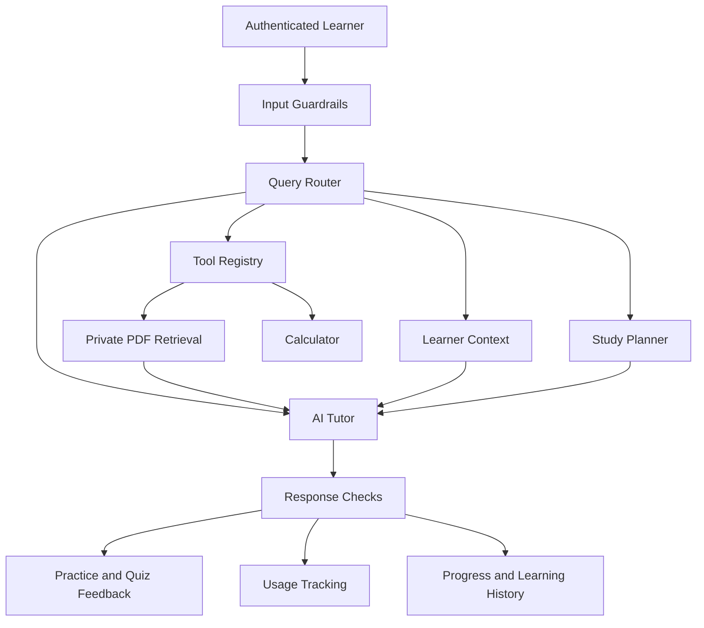

# 🎓 Lumina Tutor — Agentic AI Teaching Assistant

<p align="center">
  <strong>An Adaptive AI Tutor That Teaches, Evaluates, and Adapts to Every Learner</strong>
</p>

<p align="center">
  <a href="https://lumina-tutor-agent.streamlit.app/">🚀 Live Demo</a> ·
  <a href="https://github.com/AfzalManihar/lumina-tutor-Agent">💻 GitHub Repository</a>
</p>

<p align="center">
  
  
  
  
  
  
  
</p>

## 📌 Overview

**Lumina Tutor** is an AI-powered learning platform designed to make learning more personalized, structured, and adaptive.

Instead of simply answering questions or generating quizzes, the platform aims to understand learning difficulties, explain concepts, provide worked examples, evaluate learner responses, and adapt its teaching strategy when a learner struggles.

The project brings together two complementary capabilities:

- **AI Teaching Assistant:** Topic-based course generation, structured lessons, quizzes, progress tracking, and optional PDF-grounded learning.
- **Lumina Adaptive Tutor:** Adaptive tutoring strategies, guided hints, teach-back exercises, mastery tracking, spaced revision, and human-teacher handoff.

These capabilities represent complementary parts of the learning experience. The actual availability of each feature depends on the corresponding application component and its configured backend.

### 🎯 Core Philosophy

> An effective AI tutor should not just provide answers. It should help learners understand concepts, recognize mistakes, practice deliberately, and know when additional support is needed.

## ✨ Key Features

| Feature | Description |
|---|---|
| 🧠 AI Tutoring | Generates contextual explanations using a configured language model. |
| 📚 Topic-Based Courses | Creates private courses from a topic without requiring a PDF. |
| 📄 PDF-Grounded Learning | Uses optional PDF sources to ground supported course and chat workflows. |
| 🪜 Adaptive Teaching | Changes teaching strategies when learners repeatedly struggle. |
| 💡 Guided Hints | Provides incremental support instead of immediately revealing answers. |
| 🧩 Worked Examples | Demonstrates solutions before asking learners to solve similar problems. |
| 📝 Practice and Quizzes | Checks responses, provides feedback, and records quiz attempts. |
| 📊 Learning Progress | Tracks lesson completion and measurable quiz performance. |
| 🔁 Spaced Revision | Supports revision schedules at 1, 3, 7, 14, and 30 days in the adaptive tutor workflow. |
| 👤 Human Handoff | Creates a teacher handoff packet when additional help is needed. |
| 🔐 Private Learning Data | Scopes course data and private document retrieval to the authenticated learner. |
| 📈 Usage Tracking | Records token usage and applies application-level usage limits where configured. |
| 🛡️ Agent Guardrails | Applies input limits, bounded workflows, and checks for untrusted document content. |

## 🏗️ Architecture

The project has two related application paths: a course platform with a FastAPI backend and a Streamlit-based adaptive tutoring experience.

### 1. AI Teaching Assistant Architecture

- **Frontend:** Streamlit and the static Lumina web client.
- **Backend:** FastAPI.
- **Language model:** Groq.
- **Database:** MongoDB.
- **Document retrieval:** Google AI embeddings and Pinecone.
- **Course generation:** Topic → curriculum → modules → lessons → practice and quizzes.

### 2. Adaptive Tutor Architecture

- **User interface:** Streamlit.
- **Agent workflow:** LangGraph in the separate live-engine workflow.
- **Model inference:** Groq in the live engine.
- **Validation:** Pydantic schemas and lesson-quality checks.
- **Learning experience:** Diagnostic questions, progressive support, mastery checks, and teacher handoff.

The hosted Streamlit demo can run with a built-in sample lesson when the separate live engine is unavailable. The complete live-engine workflow is run separately and requires its backend bridge to be reachable.

## 🔄 How the Learning Workflow Works

### AI Teaching Assistant

1. The learner enters a topic and selects Beginner, Intermediate, or Advanced.
2. Groq generates a structured curriculum with learning objectives, modules, and lessons.
3. The learner opens a lesson and requests generated lesson content.
4. The lesson presents explanations, worked examples, practice questions, and quizzes.
5. Practice responses and quiz submissions are checked by the backend.
6. Course data, completion status, and quiz attempts are stored in MongoDB.
7. An optional private PDF can provide source material for supported learning workflows.

### Adaptive Tutor

1. A diagnostic check identifies potential knowledge gaps.
2. The tutor introduces an exercise appropriate to the learner.
3. If the learner struggles, the system escalates its teaching strategy.
4. The learner receives hints, worked examples, prerequisite checks, or alternative explanations.
5. The tutor evaluates the response and checks for mastery.
6. If the exercise remains unresolved, the tutor can prepare a human-teacher handoff.
7. Progress and spaced-revision information support continued learning.

## 🪜 Five-Level Adaptive Teaching Strategy

| Level | Strategy | Learner Experience |
|:---:|---|---|
| 1 | Hint + new variant | Receives a small hint and another question testing the same skill. |
| 2 | Worked example | Studies a solved example and then attempts a partially completed task. |
| 3 | Backward diagnosis | Answers prerequisite questions to identify the underlying gap. |
| 4 | New representation | Receives smaller steps, an analogy, and a teach-back activity. |
| 5 | Human handoff | The unresolved exercise is parked and a handoff packet is prepared. |

### Additional Adaptation Rules

- Mastery requires two correct answers on different variants of the same exercise.
- Repeating the same mistake twice can trigger prerequisite diagnosis.
- A correct answer with an insufficient explanation does not automatically count as mastery.
- Different error patterns can trigger different teaching responses.
- Parking one exercise should not necessarily prevent the learner from continuing unrelated activities.

These rules describe the adaptive tutor workflow; they should not be assumed to run in every course-platform route.

## 🤖 Agentic AI Workflow

The course platform includes an orchestrated tutor workflow with guardrails, learner memory, routing, tutoring or optional retrieval, response checks, and usage logging.

The adaptive tutor separately uses a LangGraph workflow in its live-engine implementation.

A conceptual workflow is:



The diagram is conceptual and summarizes the workflow stages; it does not imply that every stage executes for every request.

### Agent Responsibilities

| Component | Responsibility |
|---|---|
| Guardrails | Bounds inputs and treats learner/document text as untrusted. |
| Router | Selects a supported tutoring, arithmetic, or document-question path. |
| Planner | Helps organize multi-part study requests when needed. |
| Tool Registry | Exposes bounded tools with validated arguments and permissions. |
| RAG | Retrieves authorized document chunks and supports source citations. |
| Tutor | Generates explanations and learning guidance. |
| Evaluation | Applies response-quality heuristics and supported evidence checks. |
| Memory | Stores permitted, account-scoped learner context. |
| Usage Controller | Reserves estimated tokens and enforces application quotas. |

**Important:** Quality rubrics and deterministic evidence checks are not guarantees of factual correctness. Ungrounded responses should not be presented as independently fact-checked.

## 📚 Course Generation and Lesson Structure

The topic-based course platform supports:

- Creating a course without uploading a document.
- Selecting a learning level.
- Generating a curriculum with objectives, modules, and lessons.
- Generating structured lesson content on demand.
- Checking practice answers.
- Generating quizzes and grading submitted answers.
- Recording lesson completion and quiz history.
- Optionally grounding a private course in an uploaded PDF.

The intended teaching sequence is:

**Concept explanation → Worked example → Guided practice → Quiz → Feedback and revision**

Practice expected answers and quiz answer keys should remain server-side.

## 📄 Retrieval-Augmented Generation (RAG)

The document-grounded workflow uses embeddings and vector search to retrieve relevant material from indexed PDFs.

### Document workflow

1. An authorized user uploads a supported PDF.
2. The application extracts available text and indexes document chunks.
3. Google AI embeddings represent the chunks for semantic retrieval.
4. Pinecone retrieves relevant chunks for a supported question.
5. The model generates a response using retrieved context.
6. The response can include filename and page citations derived from retrieved chunks.

### Privacy and limitations

- Private learner documents are filtered by owner.
- Teacher-upload access follows the existing grade-based behavior.
- Retrieval is limited to a bounded number of chunks and context size.
- Scanned PDFs without extractable text are not OCR-processed by the described implementation.
- Retrieved documents are treated as untrusted content, not system instructions.
- Source-grounded responses are only as reliable as the retrieved evidence and verification process.

Topic-only tutoring and course generation use Groq and do not require Pinecone or Google AI embeddings. PDF indexing and existing document-grounded features require their corresponding provider configuration.

## 🛠️ Tech Stack

| Technology | Purpose |
|---|---|
| Python 3.10+ | Application logic |
| FastAPI | Backend APIs |
| Streamlit | Interactive application interface |
| HTML, CSS, JavaScript | Static Lumina web client |
| LangChain | LLM and retrieval integrations in applicable workflows |
| LangGraph | Adaptive tutor and agent workflow orchestration |
| Groq | Language-model inference |
| MongoDB | Accounts, courses, progress, usage, and learning history |
| Google AI | PDF embeddings |
| Pinecone | Vector retrieval |
| Pydantic | Request, response, and structured-data validation |
| Pytest | Automated testing |
| Render | Prepared deployment configuration |

## ⚙️ Requirements

- Python 3.10 or newer.
- MongoDB, local or hosted.
- Groq API key for topic-based course generation and configured tutor workflows.
- Google AI API key for PDF embeddings.
- Pinecone API key and index for document retrieval.
- Razorpay credentials and a configured plan only if paid subscriptions are required.

The optional RAG and payment features should not prevent the application from starting when their configuration is intentionally optional.

## 💻 Local Setup — AI Teaching Assistant

### 1. Clone the repository

```powershell
git clone https://github.com/AfzalManihar/lumina-tutor-Agent.git
cd lumina-tutor-Agent
```

**Note:** The AI Teaching Assistant documentation describes an `AI-Teaching-Assistant` project layout. Confirm that the course-platform files are present in your checkout before using its backend commands. The public Lumina repository and that separate course-platform layout should not be assumed to contain identical files.

### 2. Create a virtual environment

From the relevant project root:

```powershell
py -3.10 -m venv .venv
.\.venv\Scripts\Activate.ps1
python -m pip install --upgrade pip
```

If the `py` launcher is unavailable, use:

```powershell
python -m venv .venv
.\.venv\Scripts\Activate.ps1
```

### 3. Install dependencies

For the course-platform project, if its development requirements file exists:

```powershell
python -m pip install -r requirements-dev.txt
```

For the public Lumina Streamlit project, use the repository's `requirements.txt`:

```powershell
python -m pip install -r requirements.txt
```

Install dependencies from the requirements file belonging to the application you are running.

### 4. Configure environment variables

Copy `.env.example` to `.env` when that example file is available. Fill in the required values:

```dotenv
MONGO_URI=
DB_NAME=ai_tutor

GROQ_API_KEY=
GROQ_MODEL=

GOOGLE_API_KEY=
GOOGLE_EMBEDDING_MODEL=

PINECONE_API_KEY=
PINECONE_INDEX_NAME=

CORS_ORIGINS=
BACKEND_URL=

RAZORPAY_KEY_ID=
RAZORPAY_KEY_SECRET=
RAZORPAY_WEBHOOK_SECRET=
RAZORPAY_PLAN_ID_PRO=
```

Keep real credentials in environment variables. Never commit `.env` or publish API keys in source code, screenshots, logs, or README files.

`MONGO_URI` is required for account-backed persistence in the course platform, and `GROQ_API_KEY` is required for model-generated course content. Google AI and Pinecone are required for the described PDF retrieval features. Razorpay is optional unless subscription billing is enabled.

### 5. Start MongoDB

Ensure the MongoDB service or hosted cluster is running and accessible using `MONGO_URI`.

## 🚀 Run the Applications

### Option A — AI Teaching Assistant API

From the course-platform project root, open a terminal:

```powershell
.\.venv\Scripts\Activate.ps1
Set-Location server
uvicorn main:app --reload
```

The default API address is:

- API: `http://127.0.0.1:8000`
- Interactive documentation: `http://127.0.0.1:8000/docs`
- Health check: `http://127.0.0.1:8000/health`

### Option B — Streamlit Course Client

From the course-platform project root, open another terminal:

```powershell
.\.venv\Scripts\Activate.ps1
Set-Location client
streamlit run main.py
```

### Option C — Static Lumina Web Client

When the course-platform implementation contains the static `client/lumina/` interface and serves it from `server/main.py`, start the FastAPI service and open:

`http://127.0.0.1:8000`

The static client uses the same origin as the API. It does not require a separate Vite build.

### Option D — Public Lumina Streamlit Demo

In the public Lumina repository, run:

```powershell
python -m pip install -r requirements.txt
streamlit run app.py
```

Open:

`http://localhost:8501`

The demo can use its built-in sample lesson when the live engine is unavailable. To connect a running backend bridge in Windows PowerShell:

```powershell
$env:TUTOR_BACKEND_URL="http://127.0.0.1:8765"
streamlit run app.py
```

The bridge must be running and reachable. The separate live-engine workflow may require additional setup in Google Colab.

## 🔌 API Reference — Course Platform

The following routes belong to the described FastAPI course-platform implementation. Confirm their presence in `/docs` before using them.

| Method | Endpoint | Purpose |
|---|---|---|
| POST | `/courses/sources` | Upload an optional private PDF |
| POST | `/courses` | Generate and save a topic curriculum |
| GET | `/courses` | List the learner's courses |
| GET | `/courses/{course_id}` | Retrieve a learner-owned course |
| POST | `/courses/{course_id}/lessons/{lesson_id}/generate` | Generate lesson content |
| GET | `/courses/{course_id}/lessons/{lesson_id}` | Retrieve lesson content |
| POST | `/courses/{course_id}/lessons/{lesson_id}/practice` | Check practice responses |
| POST | `/courses/{course_id}/lessons/{lesson_id}/quiz` | Grade and save a quiz attempt |
| POST | `/courses/{course_id}/lessons/{lesson_id}/progress` | Save lesson completion |
| POST | `/tutor/chat` | Run the configured tutor workflow |
| POST | `/chat` | Use document-grounded chat |
| POST | `/tutor/quiz` | Generate a quiz |
| POST | `/tutor/quiz/check` | Check quiz answers |
| GET | `/learning/history` | Retrieve learning history |
| GET | `/learning/accuracy` | Report measurable quiz accuracy |
| GET | `/usage` | Retrieve token usage and quota information |
| DELETE | `/memory` | Delete the authenticated learner's saved memory |
| POST | `/billing/webhook` | Process configured Razorpay webhook events |

Account creation, authentication, and document-upload routes from the existing application are intended to remain available. Consult the running API documentation for their exact schemas and authentication requirements.

## 🔐 Authentication, Privacy, and Security

The course-platform design includes the following protections:

- Course reads and writes are scoped to the authenticated user's ID.
- Private PDF retrieval is filtered by owner.
- Quiz answer keys and practice expected answers remain server-side.
- Quiz submissions validate answer counts and course/quiz ownership.
- Teacher PDF uploads require the appropriate authenticated role.
- Learner memory is account-scoped and user-controlled.
- Learner chat-topic storage requires explicit opt-in in the described agentic implementation.
- Request size, model output, agent steps, and retrieval context are bounded.
- Untrusted document and learner text should not override system instructions.
- Application traces should omit prompts, answers, and document text.

The browser client described for the course platform keeps credentials in memory for the current tab and sends them using HTTP Basic authentication. Deploy behind HTTPS and review the complete authentication implementation before production use.

These safeguards reduce risk but do not replace a professional security audit.

## 📊 Token Usage and Limits

The described course platform supports application-level usage controls.

- `USER_MONTHLY_TOKEN_LIMIT` defaults to 250,000 tokens per student.
- Individual requests have a documented estimated-token cap.
- Requests can be rejected with HTTP 429 when the estimated budget exceeds the remaining quota.
- Estimated usage is reserved before model calls where the atomic budget implementation is enabled.
- Provider-reported token usage is recorded when available.
- Estimated and provider-reported counts should be distinguished in monitoring.

These limits control application usage; they do not guarantee a specific provider bill. Actual provider billing and rate limits must be monitored separately.

## 💳 Optional Razorpay Subscription Billing

The course-platform design supports a subscription checkout flow and signed, idempotently processed webhook events.

Configuration variables:

```dotenv
RAZORPAY_KEY_ID=
RAZORPAY_KEY_SECRET=
RAZORPAY_WEBHOOK_SECRET=
RAZORPAY_PLAN_ID_PRO=
SUBSCRIPTION_TOKEN_LIMIT_PRO=1000000
```

Before enabling real payments:

1. Obtain the appropriate credentials through Razorpay's account onboarding process.
2. Create and verify the subscription plan in the Razorpay dashboard.
3. Configure the webhook URL and required events.
4. Verify webhook signatures and handle duplicate events safely.
5. Test the complete checkout and subscription lifecycle in Test Mode before enabling Live Mode.

Razorpay onboarding and access to credentials depend on the account's verification requirements. If payment configuration is absent, payment-dependent activation may not work; other application features can still work if billing is implemented as optional.

Never use fake credentials or another person's PAN to bypass payment-provider verification.

## 🧪 Testing

For the course-platform project, run its unit and API tests from the project root:

```powershell
.\.venv\Scripts\Activate.ps1
python -m pytest server/tests -v
```

A concise test run is:

```powershell
python -m pytest server/tests -q
```

The described tests use mocked provider and database boundaries. They are intended to verify application logic without requiring live Groq, MongoDB, Google AI, or Pinecone calls.

The separate diagnostic script `server/test.py`, when present, checks selected configuration flags. It is not a substitute for the test suite and should not print secret values.

For the public Lumina Streamlit project, follow the tests and scripts actually included in that repository.

### Suggested Manual Test Checklist

- [ ] Start the application with optional RAG credentials absent.
- [ ] Verify that the health route distinguishes configuration from service connectivity.
- [ ] Create a course using a topic without uploading a PDF.
- [ ] Open a lesson and check that explanations and worked examples appear before practice.
- [ ] Submit an incorrect practice answer and inspect the feedback.
- [ ] Submit a quiz and verify that answers are graded server-side.
- [ ] Confirm that lesson progress persists for the correct user.
- [ ] Upload a supported PDF and verify grounded responses and citations.
- [ ] Confirm that one learner cannot access another learner's private course or PDF.
- [ ] Test quota enforcement and missing-provider configuration.
- [ ] Test Razorpay in Test Mode separately from normal tutoring.
- [ ] Verify that the adaptive tutor demo and live-engine paths behave as documented.

Passing mocked tests does not prove live provider availability, factual accuracy, payment settlement, or production security.

## ☁️ Deployment

The course-platform project includes a `render.yaml` deployment blueprint when that file is present. It is intended to run FastAPI and serve the static Lumina web client from one service.

Deployment checklist:

1. Push the correct project files to a Git repository.
2. Connect the repository to Render.
3. Configure MongoDB network access for the deployment environment.
4. Set required environment variables in the hosting dashboard.
5. Add optional Google AI and Pinecone credentials if PDF retrieval is required.
6. Configure Razorpay only if paid subscriptions are being enabled.
7. Verify the `/health` endpoint and actual service connectivity.
8. Test account creation, course generation, persistence, retrieval, and usage limits.
9. Configure HTTPS, backups, monitoring, log redaction, and data-retention policies.

The deployment configuration is a blueprint, not proof that the service has already been deployed. Live external credentials and cloud service availability must be verified separately.

The public Streamlit demo is available at:

**https://lumina-tutor-agent.streamlit.app/**

Its presenter controls support demonstration of learner scenarios, including repeated incorrect answers and mastery feedback. Metrics based on scripted learner cohorts are synthetic demonstration data, not outcomes collected from real students.

## 📁 Repository Structure

The public Lumina Streamlit project is documented with this structure:

```text
lumina-tutor-Agent/
├── app.py
├── requirements.txt
├── README.md
└── LICENSE
```

The course-platform implementation is documented with a separate layout:

```text
AI-Teaching-Assistant/
├── server/
│   ├── main.py
│   └── tests/
├── client/
│   ├── main.py
│   └── lumina/
├── requirements-dev.txt
├── .env.example
└── render.yaml
```

These are documentation layouts for the two application paths. They should not be treated as a verified listing of a single combined repository. Update the structure after checking the actual project files.

## ⚠️ Known Limitations

- The live tutor workflow depends on its separately running engine and backend bridge.
- The course-platform API and the public Streamlit demo are not automatically the same application.
- Topic-only course generation does not require RAG credentials, but PDF-grounded features do.
- Scanned PDFs without extractable text are not OCR-processed in the described course platform.
- Deterministic evidence checks may miss paraphrases or accept superficial text overlap.
- A response-quality rubric is not a validated factual-accuracy score.
- Synthetic evaluation fixtures are examples of metric wiring, not real-world benchmarks.
- Local tests do not verify live payment settlement or external-provider availability.
- Production use requires proper authentication review, monitoring, backups, and deployment hardening.

## 🗺️ Future Improvements

Potential extensions include:

- OCR support for scanned learning material.
- More robust semantic and hybrid retrieval.
- Improved source-grounded answer verification.
- Real-world learner-outcome evaluation.
- More detailed accessibility and multilingual support.
- Background jobs for long-running lesson generation.
- Distributed tracing and observability.
- Better teacher analytics and cohort-level insights.
- Production testing for payment webhooks and subscription lifecycle events.

These are possible future improvements, not claims that the functionality is already implemented.

## 👨‍💻 Author

**Afzal Manihar**

Interested in Agentic AI, Generative AI, Data Science, Machine Learning, and practical AI applications.

- **GitHub:** https://github.com/AfzalManihar
- **LinkedIn:** https://www.linkedin.com/in/afzal-manihar-bb0183308/
- **Portfolio:** https://afzalmanihar.github.io
- **Live Demo:** https://lumina-tutor-agent.streamlit.app/

## 📄 License

This project is licensed under the MIT License, subject to the license file included in the relevant repository. See `LICENSE` for details.

---

<p align="center">
  <strong>Built to explore more adaptive, transparent, and learner-centered AI tutoring.</strong>
</p>

<p align="center">
  ⭐ If you find the project interesting, consider starring the repository!
</p>
