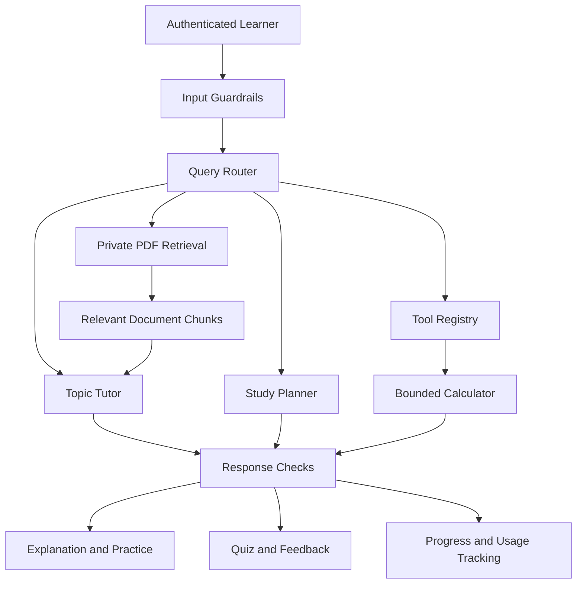

# 🎓 Lumina Tutor — Adaptive Agentic AI Teaching Assistant

<p align="center">
  <strong>Learn Smarter. Practice Better. Master Every Concept.</strong>
</p>

<p align="center">
  An AI-powered learning platform that adapts its teaching strategy to the learner — from concept explanations and worked examples to personalized practice, mastery tracking, and human-teacher support.
</p>

<p align="center">
  <a href="https://lumina-ai-tutor-b5229.containers.snapdeploy.app/app">
    
  </a>
  <a href="https://github.com/AfzalManihar/lumina-ai-tutor">
    
  </a>
</p>

<p align="center">
  
  
  
  
  
  
  
  
</p>

---

## 📌 About the Project

**Lumina Tutor** is an AI-powered tutoring project focused on personalized learning, structured instruction, and adaptive problem-solving.

Traditional learning applications often provide the same explanation regardless of whether a learner understands the concept. Lumina explores a different approach: detect learning difficulties, change the teaching strategy, and provide support that helps the learner understand *why* an answer is correct.

The broader project combines three areas:

- **AI Teaching Assistant:** Topic-based course creation, structured lessons, practice questions, quizzes, and learning progress.
- **Adaptive AI Tutor:** Progressive hints, worked examples, prerequisite diagnosis, mastery checks, spaced revision, and teacher handoff.
- **Agentic AI Workflow:** Guardrails, query routing, optional planning, bounded tools, document retrieval, response checks, and usage tracking.

The course-platform and adaptive-tutor implementations may run through separate application paths. Refer to the setup instructions for the relevant component.

### 🎯 Our Goal

> Build an AI tutor that knows when to explain, when to demonstrate, when to let learners practice, and when to provide additional help.

## ✨ Key Features

| Feature | Description |
|---|---|
| 🧠 AI Tutoring | Generates contextual explanations using a configured language model. |
| 📚 Topic-Based Learning | Creates courses from a topic without requiring a PDF. |
| 🗂️ Structured Curriculum | Organizes learning objectives, modules, and lessons. |
| 💡 Worked Examples | Demonstrates a solution before asking learners to solve a similar problem. |
| ✍️ Guided Practice | Helps learners develop understanding through supported exercises. |
| 📝 AI-Generated Quizzes | Creates structured questions and checks submitted answers. |
| 🪜 Adaptive Teaching | Changes teaching strategies when learners struggle. |
| 🔍 Prerequisite Diagnosis | Helps identify underlying knowledge gaps. |
| 📄 PDF-Grounded Learning | Uses supported private document sources for retrieval-based answers. |
| 📊 Learning Dashboard | Displays learning progress, mastery indicators, and error signals in the adaptive tutor. |
| 🔁 Spaced Revision | Supports review intervals of 1, 3, 7, 14, and 30 days in the adaptive tutor workflow. |
| 👤 Human Handoff | Can prepare a teacher handoff packet for unresolved exercises. |
| 🔐 User-Scoped Data | Keeps course records and private document retrieval scoped to the authenticated learner. |
| 🧠 Learner Memory | Supports account-scoped learning context in the configured agentic workflow. |
| 📈 Token Usage Tracking | Records estimated or provider-reported usage where supported. |
| 💳 Optional Subscriptions | Provides a documented integration path for Razorpay billing. |

Feature availability depends on the application component, configuration, and connected services.

## 🖥️ Live Demo

**[Launch Lumina Tutor](https://lumina-ai-tutor-b5229.containers.snapdeploy.app/app)**

The hosted application deployed on SnapDeploy provides a demonstration mode with a built-in sample lesson:

*Fetch a web page with Python requests.*

You can explore the tutoring interface without configuring an API key or running the full engine locally.

The complete LangGraph engine runs separately in Google Colab and can connect through a backend bridge when that engine is running and reachable.

### Try It in 60 Seconds

1. Open the [live demo](https://lumina-ai-tutor-b5229.containers.snapdeploy.app/app).
2. Find **Presenter controls** in the sidebar.
3. Select **Presenter: one weak spot** during the quick check.
4. Repeatedly select **Presenter: wrong answer**.
5. Observe the tutor escalate through its five teaching levels.
6. Explore the teacher handoff experience.
7. Start a new session and select **Presenter: correct answer** to explore mastery feedback and revision scheduling.

Presenter controls simulate learner scenarios for demonstration. Scripted cohort metrics are synthetic and should not be interpreted as real-world student outcomes.

## 🏗️ System Architecture

The project documents a course-generation platform and an adaptive tutoring application. They share a learning vision but have different execution paths.

### AI Teaching Assistant

- **Frontend:** React, Vite, TypeScript, HTML, CSS, and JavaScript.
- **Backend:** FastAPI.
- **LLM provider:** Groq.
- **Database:** MongoDB.
- **Embeddings:** Google AI.
- **Vector retrieval:** Pinecone.
- **Testing:** Pytest.

### Adaptive Tutor

- **Interface:** React-based web interface.
- **Agent orchestration:** LangGraph in the live-engine workflow.
- **Model inference:** Groq in the live engine.
- **Data validation:** Pydantic.
- **Instructional design:** Structured lesson blueprints, exercises, and quality checks.
- **Learning feedback:** Mastery tracking, adaptive support, and teacher handoff.

### High-Level Workflow



This is a conceptual overview of the documented workflow stages, not a claim that every component executes for every request.

## 📚 Learning Experience

The intended teaching sequence is:

**Concept Explanation → Worked Example → Guided Practice → Quiz → Feedback → Revision**

### 1. Create a Course

Learners enter a topic and choose Beginner, Intermediate, or Advanced. The course-generation workflow uses Groq to create a structured curriculum.

### 2. Learn the Concept

Lessons are designed to explain the concept in understandable steps and demonstrate how it works.

### 3. Study a Worked Example

Learners see a solved example before attempting a similar problem independently.

### 4. Practice with Guidance

Practice questions help learners apply the concept. Incorrect responses should receive useful feedback and appropriate support.

### 5. Test Understanding

Structured quizzes check learner understanding. Answer keys remain on the server in the described course-platform implementation.

### 6. Track Progress

Course completion and quiz attempts can be stored in MongoDB, scoped to the authenticated learner.

### 7. Revise and Improve

The adaptive tutor supports mastery checks, spaced revision, and additional teaching strategies when a learner struggles.

## 🪜 The Five-Level Adaptive Teaching System

The adaptive tutor uses a progressive failure-response ladder instead of simply repeating the same explanation.

| Level | Strategy | What the Learner Receives |
|:---:|---|---|
| 1 | Hint + New Variant | A small hint and a different question testing the same skill. |
| 2 | Worked Example | A solved example followed by a partially completed task. |
| 3 | Backward Diagnosis | Questions that check prerequisite understanding. |
| 4 | New Representation | Smaller steps, an analogy, and a teach-back activity. |
| 5 | Human Handoff | The exercise is parked and a teacher handoff packet is prepared. |

### Additional Adaptation Rules

- **Mastery:** Requires two correct answers on different variants of the same exercise.
- **Repeated mistakes:** Repeating the same mistake twice can trigger prerequisite diagnosis.
- **Weak explanations:** A correct answer with an insufficient explanation does not automatically count as mastery.
- **Different error patterns:** Fast incorrect answers, slow incorrect answers, and dependence on hints can lead to different responses.
- **Partial progress:** Parking one exercise should not necessarily block unrelated learning activities.

These rules describe the adaptive tutor workflow and should not be assumed to run in every course-platform endpoint.

## 🤖 Agentic AI Design

The course-platform implementation documents an orchestrated workflow that can combine guardrails, learner context, routing, tutoring, optional retrieval, response checks, and usage logging.

### Agent Responsibilities

| Component | Responsibility |
|---|---|
| Guardrails | Bounds inputs and treats learner and document text as untrusted. |
| Router | Selects a supported tutoring, arithmetic, or document-question path. |
| Planner | Helps organize multi-part study requests when required. |
| Tool Registry | Exposes bounded tools with validated arguments and permissions. |
| Calculator | Supports permitted arithmetic operations. |
| RAG Agent | Retrieves authorized PDF chunks and supplies source evidence. |
| Tutor | Generates explanations and learning guidance. |
| Evaluation | Applies response-quality heuristics and supported evidence checks. |
| Memory | Stores permitted, account-scoped learner context. |
| Usage Controller | Reserves estimated tokens and enforces configured application quotas. |

### Instructional Design

The adaptive tutor's lesson-design workflow is based on concepts from:

- **Gagné's Nine Events of Instruction**
- **Merrill's First Principles of Instruction**

The documented workflow separates lesson creation and validation from learner-facing tutoring.

The lesson-building process includes structured schemas, lesson blueprints, content generation, quality checks, simulated learner attempts, and a repair loop.

The learner-facing process handles diagnostic routing, exercises, adaptive support, mastery checks, revision, and human escalation.

## 📄 Retrieval-Augmented Generation (RAG)

RAG enables supported document-grounded workflows to use a learner's own study material.

### How It Works

1. The learner uploads a supported PDF.
2. The application extracts available text and creates document chunks.
3. Google AI generates embeddings for the chunks.
4. Pinecone indexes the vectors for similarity-based retrieval.
5. The application retrieves relevant chunks for a question.
6. The language model generates a response using the retrieved context.
7. Supported responses can include filename and page citations derived from retrieved chunks.

### Privacy and Limitations

- Private learner documents are filtered by owner.
- Existing teacher uploads retain their documented grade-based access behavior.
- Retrieval uses bounded chunk counts and context sizes.
- Scanned PDFs without extractable text are not OCR-processed in the described course platform.
- Retrieved documents are treated as untrusted content, not system instructions.
- Citations indicate retrieved source material but do not guarantee that every generated claim is correct.

**Important:** Topic-only course generation does not require Google AI embeddings or Pinecone. PDF indexing and document-grounded features do require their corresponding configuration.

## 🛠️ Technology Stack

| Technology | Purpose |
|---|---|
| Python 3.10+ | Core application logic |
| FastAPI | Backend APIs |
| React, Vite, TypeScript | Interactive UI |
| HTML, CSS, JavaScript | Static web client |
| LangChain | LLM and retrieval integrations in applicable workflows |
| LangGraph | Agent workflow orchestration |
| Groq | Language-model inference |
| MongoDB | Accounts, courses, progress, and usage data |
| Google AI | PDF embeddings |
| Pinecone | Vector search and retrieval |
| Pydantic | Structured data validation |
| Pytest | Automated testing |
| Render | Prepared deployment configuration |

The use of each technology depends on the application component being run.

## ⚙️ Requirements

- Python 3.10 or newer.
- MongoDB, local or hosted, for the course platform's account and persistence features.
- Groq API key for generated courses and configured tutor workflows.
- Google AI API key for PDF embeddings.
- Pinecone API key and index for document retrieval.
- Razorpay account and configured credentials only if paid subscriptions are enabled.

## 💻 Installation and Setup

### Step 1: Clone the Repository

```powershell
git clone https://github.com/AfzalManihar/lumina-tutor-Agent.git
cd lumina-tutor-Agent
```

### Step 2: Create a Virtual Environment

```powershell
py -3.10 -m venv .venv
.\.venv\Scripts\Activate.ps1
python -m pip install --upgrade pip
```

If the `py` launcher is unavailable, use:

```powershell
python -m venv .venv
.\.venv\Scripts\Activate.ps1
```

### Step 3: Install Dependencies

For the Lumina project:

```powershell
python -m pip install -r requirements.txt
```

For the separate course-platform project, if `requirements-dev.txt` is present:

```powershell
python -m pip install -r requirements-dev.txt
```

Use the requirements file that belongs to the application you are running. The two project layouts should not be assumed to be identical.

### Step 4: Configure Environment Variables

Copy `.env.example` to `.env` if the file exists in the relevant project root.

Example configuration:

```dotenv
# Database
MONGO_URI=
DB_NAME=ai_tutor

# Language model
GROQ_API_KEY=
GROQ_MODEL=

# Optional PDF retrieval
GOOGLE_API_KEY=
GOOGLE_EMBEDDING_MODEL=
PINECONE_API_KEY=
PINECONE_INDEX_NAME=

# Optional frontend/backend connection
BACKEND_URL=

# Optional trusted frontend origins
CORS_ORIGINS=

# Optional Razorpay billing
RAZORPAY_KEY_ID=
RAZORPAY_KEY_SECRET=
RAZORPAY_WEBHOOK_SECRET=
RAZORPAY_PLAN_ID_PRO=
SUBSCRIPTION_TOKEN_LIMIT_PRO=1000000

# Optional usage configuration
USER_MONTHLY_TOKEN_LIMIT=250000
```

Keep real credentials in `.env` or your hosting provider's environment settings. Never commit actual API keys or payment secrets to GitHub.

The course platform requires `MONGO_URI` for account-backed persistence and `GROQ_API_KEY` for generated course content. Google AI and Pinecone are needed for the described PDF retrieval features. Payment variables are optional unless billing is enabled.

### Step 5: Start MongoDB

Ensure MongoDB is running and reachable if you are using the course-platform application.

## 🚀 Running the Application

### Option A: Run the Lumina Frontend

From the public repository root:

```powershell
npm install
npm run dev
```

Open:

**http://localhost:5173**

The demo can run with its built-in sample lesson when the live engine is unavailable.

### Option B: Run the Course-Platform Backend

From the course-platform project root, open a terminal:

```powershell
.\.venv\Scripts\Activate.ps1
Set-Location server
uvicorn main:app --reload
```

Default endpoints:

- Application/API: `http://127.0.0.1:8000`
- API documentation: `http://127.0.0.1:8000/docs`
- Health endpoint: `http://127.0.0.1:8000/health`

### Option C: Run the Course-Platform Frontend

Open another terminal from the course-platform root:

```powershell
.\.venv\Scripts\Activate.ps1
Set-Location client
npm run dev
```

### Option D: Run the Static Lumina Web Client

If the course-platform implementation contains `client/lumina/` and serves it from `server/main.py`, start the FastAPI backend and open:

**http://127.0.0.1:8000**

The described static client uses the same origin as the API and does not require a separate Vite build.

### Connect the Adaptive Tutor to a Live Engine

If the adaptive tutor's backend bridge is running locally, configure its address before launching the frontend.

**Windows PowerShell:**

```powershell
$env:TUTOR_BACKEND_URL="http://127.0.0.1:8765"
npm run dev
```

**macOS/Linux:**

```bash
export TUTOR_BACKEND_URL="http://127.0.0.1:8765"
npm run dev
```

The live engine must be running and reachable. Its complete workflow is documented as a separate Google Colab-based component.

## 🔌 API Reference

The following routes belong to the documented course-platform implementation. Confirm their presence and schemas in `/docs` before relying on them.

| Method | Endpoint | Description |
|---|---|---|
| `POST` | `/courses/sources` | Upload an optional private PDF |
| `POST` | `/courses` | Generate and save a topic curriculum |
| `GET` | `/courses` | List the learner's courses |
| `GET` | `/courses/{course_id}` | Retrieve a learner-owned course |
| `POST` | `/courses/{course_id}/lessons/{lesson_id}/generate` | Generate structured lesson content |
| `GET` | `/courses/{course_id}/lessons/{lesson_id}` | Retrieve lesson content |
| `POST` | `/courses/{course_id}/lessons/{lesson_id}/practice` | Check practice responses |
| `POST` | `/courses/{course_id}/lessons/{lesson_id}/quiz` | Grade and save a quiz attempt |
| `POST` | `/courses/{course_id}/lessons/{lesson_id}/progress` | Save lesson completion |
| `POST` | `/tutor/chat` | Run the configured tutor workflow |
| `POST` | `/chat` | Use document-grounded chat |
| `POST` | `/tutor/quiz` | Generate structured quiz questions |
| `POST` | `/tutor/quiz/check` | Check quiz answers |
| `GET` | `/learning/history` | Retrieve learning history |
| `GET` | `/learning/accuracy` | Report measured quiz-answer accuracy |
| `GET` | `/usage` | Retrieve token usage and quota information |
| `DELETE` | `/memory` | Delete the authenticated learner's saved memory |
| `POST` | `/billing/webhook` | Process configured Razorpay webhook events |

Authentication, account creation, and other existing routes should be checked in the actual running API documentation.

## 🔐 Security and Privacy

The documented course-platform implementation includes:

- User-scoped course reads and writes.
- Owner-filtered private document retrieval.
- Server-side practice answers and quiz answer keys.
- Quiz ownership and answer-count validation.
- Role checks for teacher document uploads.
- Account-scoped learner memory.
- Bounded request sizes, model outputs, retrieval context, and agent steps.
- Treatment of learner input and retrieved document text as untrusted.
- Structured traces designed to avoid logging prompts, answers, and document content.

The described browser client keeps credentials in memory for the current tab and uses HTTP Basic authentication. Production deployment must use HTTPS and should undergo a full authentication and security review.

These controls reduce risk but do not replace a security audit.

## 📈 Token Usage and Budget Control

The course-platform implementation documents application-level token usage controls.

- `USER_MONTHLY_TOKEN_LIMIT` defaults to 250,000 tokens per student.
- Requests are subject to configured request and estimated-token limits.
- Requests that exceed the remaining estimated budget can be rejected with HTTP 429.
- Estimated tokens can be reserved before model calls where the atomic budget implementation is enabled.
- Provider-reported token usage is recorded when available.
- Estimated and provider-reported counts are distinguished where supported.

These controls help manage application usage but do not guarantee provider billing amounts or prevent all provider-side rate limits.

## 💳 Optional Razorpay Subscription Billing

The course-platform documentation describes a subscription integration with signed and idempotently processed webhook events.

Configure these variables only when enabling billing:

```dotenv
RAZORPAY_KEY_ID=
RAZORPAY_KEY_SECRET=
RAZORPAY_WEBHOOK_SECRET=
RAZORPAY_PLAN_ID_PRO=
SUBSCRIPTION_TOKEN_LIMIT_PRO=1000000
```

### Billing Setup

1. Complete the required Razorpay account onboarding.
2. Obtain the appropriate API credentials.
3. Create a subscription plan in the Razorpay dashboard.
4. Configure the `/billing/webhook` URL and required events.
5. Verify webhook signatures and handle duplicate events safely.
6. Test checkout, subscription activation, and cancellation in Test Mode before enabling Live Mode.

Payment-dependent functionality requires valid payment configuration. Tutoring and other unrelated features can still operate without Razorpay if billing is implemented as optional.

Do not use fake credentials or another person's PAN to bypass provider verification.

## 🧪 Testing and Verification

For the course-platform project, run the automated tests from the project root:

```powershell
.\.venv\Scripts\Activate.ps1
python -m pytest server/tests -v
```

For a concise test report:

```powershell
python -m pytest server/tests -q
```

The described course-platform tests use mocked provider and database boundaries. They are intended to verify application logic without requiring live Groq, MongoDB, Google AI, or Pinecone calls.

The diagnostic script `server/test.py`, when present, checks selected configuration flags. It is not the test suite and should not print secret values.

### Recommended Manual Test Checklist

- [ ] Start the application without optional RAG credentials.
- [ ] Verify that the health endpoint distinguishes configuration from connectivity.
- [ ] Create a topic-based course without uploading a PDF.
- [ ] Confirm that lesson explanations and worked examples precede practice.
- [ ] Submit an incorrect practice answer and inspect the feedback.
- [ ] Submit a quiz and verify server-side grading.
- [ ] Verify course progress and quiz history persistence.
- [ ] Upload a supported PDF and check document-grounded answers and citations.
- [ ] Confirm that one learner cannot access another learner's private data.
- [ ] Test configured token quotas and missing-provider errors.
- [ ] Test the adaptive tutor demo and live-engine connection separately.
- [ ] Test Razorpay webhook handling in Test Mode if billing is enabled.

Mocked tests do not prove live service availability, model factual accuracy, successful payment settlement, or production security.

## ☁️ Deployment

The course-platform project documentation describes a `render.yaml` blueprint for serving FastAPI and the static Lumina client from a single Python web service.

### Deployment Checklist

1. Push the correct project files to GitHub.
2. Connect the repository to Render.
3. Configure MongoDB network access and credentials.
4. Add required environment variables in the hosting dashboard.
5. Add Google AI and Pinecone credentials if PDF retrieval is required.
6. Configure Razorpay only if subscriptions are enabled.
7. Verify `/health` and test actual service connectivity.
8. Test authentication, course generation, persistence, and document access.
9. Configure HTTPS, backups, monitoring, and log redaction.
10. Establish appropriate data-retention policies.

A deployment blueprint does not mean the application has already been deployed or that external credentials have been verified.

The live demo is available at:

**https://lumina-ai-tutor-b5229.containers.snapdeploy.app/app**

## 📁 Project Structure

The Lumina project is documented with this layout:

```text
lumina-tutor-Agent/
├── app.py
├── requirements.txt
├── README.md
└── LICENSE
```

The separate course-platform implementation is documented with this layout:

```text
AI-Teaching-Assistant/
├── server/
│   ├── main.py
│   └── tests/
├── client/
│   ├── main.py
│   └── lumina/
├── requirements-dev.txt
├── .env.example
└── render.yaml
```

These are the documented layouts for the two application paths, not a verified listing of a single merged repository. Update this section after checking the actual files in your project.

## ⚠️ Known Limitations

- The live adaptive tutor requires its separate engine and reachable backend bridge.
- The course-platform API and deployed SnapDeploy application are not automatically the same running application.
- PDF retrieval requires its configured embedding and vector-search providers.
- Scanned PDFs without extractable text are not OCR-processed in the described course platform.
- Deterministic evidence checks may miss paraphrases or accept superficial text overlap.
- Response-quality rubrics are not validated factual-accuracy scores.
- Synthetic evaluation fixtures are not real-world learning benchmarks.
- Automated tests do not verify live external services or payment settlement.
- Production deployment requires security review, monitoring, backups, and operational testing.

## 🔮 Future Improvements

Potential extensions include:

- OCR for scanned PDFs.
- Improved semantic and hybrid retrieval.
- Stronger source-grounded answer verification.
- More robust real-world learner-outcome evaluation.
- Multilingual tutoring and accessibility improvements.
- Background queues for long-running generation tasks.
- Distributed tracing and observability.
- Teacher analytics and cohort-level insights.
- Comprehensive live payment and subscription lifecycle testing.

These are possible future enhancements, not claims that the features are already implemented.

## 👨‍💻 Author

**Afzal Manihar**

Interested in Agentic AI, Generative AI, Data Science, Machine Learning, and building practical AI applications.

- 🌐 **Portfolio:** https://afzalmanihar.github.io
- 💻 **GitHub:** https://github.com/AfzalManihar
- 🔗 **LinkedIn:** https://www.linkedin.com/in/afzal-manihar-bb0183308/
- 🚀 **Live Demo:** https://lumina-ai-tutor-b5229.containers.snapdeploy.app/app

## 📄 License

This project is licensed under the MIT License, subject to the license file included in the relevant repository. See `LICENSE` for details.

---

<p align="center">
  <strong>Built to make AI-powered learning more adaptive, transparent, and learner-centered.</strong>
</p>

<p align="center">
  ⭐ If you find this project interesting, consider starring the repository!
</p>
